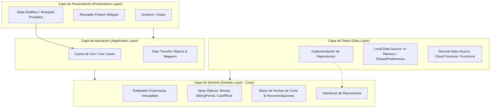

# Wallet AI - Architecture Specification

## 1. Arquitectura General del Sistema

Wallet AI sigue los principios de **Clean Architecture (Arquitectura Limpia)** y **Feature-Driven Development (FDD)**, complementada con el patrón de **Inyección de Dependencias** y **Puertos y Adaptadores (Arquitectura Hexagonal)**.

El objetivo principal es desacoplar por completo el motor de reglas financieras y la lógica de negocio de la interfaz gráfica (Flutter) y de los proveedores de persistencia (Firebase / Local Storage).



---

## 2. Capas del Sistema

### 2.1. Capa de Dominio (`core/domain` y `features/*/domain`)
* **Independiente de Frameworks**: No importa Flutter, Firebase ni paquetes externos de UI.
* **Entidades Puras**: Clases inmutables con validación de invariantes financieras (`UserCard`, `BillingCycle`, `Benefit`, `Purchase`, `Loan`, `Recommendation`).
* **Value Objects**: Manejo estricto de dinero (evitando punto flotante binario IEEE-754 mediante representación en centavos enteros o `Decimal`), fechas de corte (`CutoffRule`), porcentajes y tasas.
* **Servicios de Dominio**:
  - `BillingCycleEngine`: Motor determinista para calcular ciclos anteriores, vigentes y siguientes, días hasta el pago y días de gracia.
  - `RecommendationEngine`: Motor de reglas deterministas y multicriterio para evaluar la mejor tarjeta del día y por categoría.
  - `CashbackCalculator`: Algoritmo de cálculo de cashback y recompensas con topes mensuales/anuales y exclusiones.

### 2.2. Capa de Aplicación (`features/*/application`)
* Orquesta el flujo de datos entre la presentación y el dominio.
* Implementa los casos de uso (`GetDailyRecommendationUseCase`, `SimulatePurchaseUseCase`, `RegisterCardUseCase`, `GetFinancialCalendarUseCase`, `ManageLoansUseCase`).
* No contiene lógica de presentación ni llamadas directas a APIs de bajo nivel.

### 2.3. Capa de Presentación (`features/*/presentation`)
* Desarrollada en **Flutter 3.44+ con Material Design 3**.
* Gestión de Estado: **Riverpod 2.x** (`NotifierProvider`, `AsyncNotifierProvider`, `StreamProvider`).
* Navegación: Declarativa y modular basada en `GoRouter` o navegación por tabs + deep linking con soporte de rutas canónicas.
* Componentes desacoplados: `FintechCardWidget`, `BillingCycleProgressBar`, `RewardBadge`, `CountdownChip`, `ComparisonMatrixWidget`.

### 2.4. Capa de Datos (`features/*/data`)
* Implementa las interfaces de repositorio del dominio (`ICardRepository`, `IAuthRepository`, `IPurchaseRepository`, `ILoanRepository`, `ICatalogRepository`).
* **Dual Data Source Strategy**:
  - **Local Demo Data Source**: Permite que la aplicación sea 100% interactiva sin conexión a internet ni configuración obligatoria de Firebase.
  - **Firebase Data Source**: Integración con Firebase Authentication, Cloud Firestore y Cloud Functions para sincronización en la nube multi-dispositivo.
* Conmutador transparente mediante inyección de dependencias (`AppEnvironment.demo` vs `AppEnvironment.firebase`).

---

## 3. Estructura de Directorios

```
wallet_ai/
├── docs/                      # Documentación completa y auditable
├── app/                       # Proyecto Flutter
│   ├── lib/
│   │   ├── main.dart          # Entry point
│   │   ├── app.dart           # MaterialApp.router y configuración global
│   │   ├── core/              # Componentes compartidos del sistema
│   │   │   ├── config/        # Environment, constants, theme
│   │   │   ├── errors/        # Fallos y excepciones tipadas
│   │   │   ├── extensions/    # Date, DateTime, Currency extensions
│   │   │   ├── theme/         # Design System fintech (Dark/Light)
│   │   │   └── utils/         # Precision math, date helpers
│   │   └── features/          # Arquitectura vertical por feature
│   │       ├── authentication/# Login, Registro, AuthState
│   │       ├── cards/         # CRUD de tarjetas, ciclos, detalle
│   │       ├── benefits/      # Catálogo de beneficios y recompensas
│   │       ├── engine/        # Motor de fechas de corte y recomendaciones
│   │       ├── dashboard/     # Panel principal con recomendación del día
│   │       ├── purchases/     # Registro manual de compras y simulación
│   │       ├── calendar/      # Calendario de cortes, vencimientos y pagos
│   │       ├── loans/         # Gestión de préstamos personales
│   │       └── profile/       # Preferencias, moneda, exportación
│   └── test/                  # Pruebas unitarias, de integración y widgets
├── functions/                 # Backend Cloud Functions (TypeScript)
│   ├── src/
│   │   ├── index.ts
│   │   └── modules/
│   ├── package.json
│   └── tsconfig.json
└── firebase/                  # Configuración de Firebase
    ├── firestore.rules
    ├── firestore.indexes.json
    └── firestore.seed.json
```

---

## 4. Patrones de Diseño Aplicados

1. **Repository Pattern**: Aísla la lógica de negocio de los detalles de almacenamiento (Firestore vs SharedPreferences vs Memory).
2. **Strategy Pattern**: Aplicado en el cálculo de recompensas (`CashbackStrategy`, `PointsStrategy`, `MilesStrategy`).
3. **Builder & Factory Pattern**: Construcción de ciclos de facturación (`BillingCycleFactory`) garantizando consistencia de fechas (bisiestos, fin de mes).
4. **Observer Pattern**: Utilizado mediante Streams de Riverpod para reactividad instantánea en la UI cuando se registran compras o se editan tarjetas.
