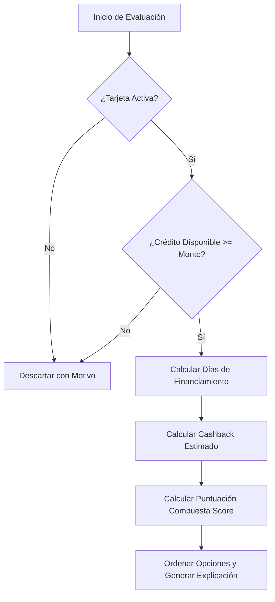

# Wallet AI - Financial Business Rules Specification

## 1. Principio Fundamental de Determinismo Financiero

Las reglas financieras de Wallet AI son **100% deterministas, matemáticas y auditables**.
No se utilizan modelos de lenguaje ni heurísticas opacas para calcular fechas, importes, intereses o cashback.
Cada recomendación viene acompañada de un objeto de desglose (`RecommendationExplanation`) que detalla las fórmulas y datos exactos utilizados.

---

## 2. Reglas del Motor de Fechas y Ciclos de Facturación (`BillingCycleEngine`)

### 2.1. Normalización de Días de Fin de Mes
* Si una tarjeta tiene día de corte `31` y el mes tiene 30 días (abril, junio, septiembre, noviembre), el corte efectivo se traslada al día `30`.
* En febrero:
  - En año común: el día `31`, `30` o `29` se normaliza al día `28`.
  - En año bisiesto: se normaliza al día `29`.
* La misma regla aplica para el `paymentDueDay`.

### 2.2. Determinación del Ciclo Asignado a una Compra
Para una compra realizada en una fecha de transacción $T$:
1. Se localiza la fecha de corte del mes en curso $C_{mes}$.
2. **Si $T \le C_{mes}$ (hasta las 23:59:59 del día de corte)**:
   - La compra pertenece al **ciclo actual**.
   - Su fecha límite de pago es $D_{actual}$ (la fecha de pago vinculada al corte $C_{mes}$).
3. **Si $T > C_{mes}$**:
   - La compra pertenece al **siguiente ciclo** ($C_{siguiente}$).
   - Su fecha límite de pago es $D_{siguiente}$.

### 2.3. Cálculo de Días de Financiamiento (Días Disponibles)
El tiempo de financiamiento sin intereses que goza una compra realizada en la fecha $T$ se calcula como la diferencia exacta en días naturales entre $T$ y la fecha límite de pago $D$ del ciclo asignado:
$$\text{Días Disponibles} = \Delta \text{días}(T \to D) = \text{DateDiffInDays}(T, D)$$

* **Ejemplo 1 (Compra óptima justo después de corte)**:
  - Tarjeta Nu: Corte día 14, Pago día 24 del mes siguiente (o 10 días tras corte).
  - Si hoy es 15 de septiembre: corte previo fue ayer (14 sep).
  - Ciclo asignado: vence con el corte del 14 de octubre y pago el 24 de octubre.
  - Días de crédito: Del 15 de septiembre al 24 de octubre = **39 días naturales**.
* **Ejemplo 2 (Compra el mismo día del corte)**:
  - Si compra el 14 de septiembre a las 11 am: entra en el estado de cuenta que corta hoy.
  - Fecha límite de pago: 24 de septiembre.
  - Días de crédito: Del 14 al 24 de septiembre = **10 días naturales**.

### 2.4. Regla de Días Inhábiles (Ajuste Bancario)
* En muchas regulaciones (ej. Ley para la Transparencia y Ordenamiento de los Servicios Financieros en México), si la fecha límite de pago coincide con un sábado, domingo o día festivo bancario, el pago puede efectuarse el día hábil inmediato posterior sin generar intereses moratorios.
* La tarjeta tiene un flag `adjustForHolidays: true/false`. Cuando esté activo, la fecha de pago efectiva se desplaza al lunes siguiente si cae en fin de semana.

---

## 3. Reglas de Cálculo de Beneficios y Cashback (`CashbackCalculator`)

### 3.1. Tipos de Beneficios Soportados
1. **Cashback Porcentual General**: Aplica a todas las compras (ej. 1% en todo).
2. **Cashback por Categoría Específica**: Aplica exclusivamente a una categoría (ej. 5% en Gasolina, 3% en Supermercados).
3. **Puntos por Importe**: Puntos acumulados por unidad monetaria (ej. 1.5 puntos por cada $1 USD o equivalente).
4. **Descuento Directo**: Descuento al corte o en terminal.

### 3.2. Prioridad de Beneficios
Si una tarjeta posee un beneficio general de 1% y un beneficio específico de 4% en Restaurantes:
* Para una compra en Restaurantes, prevalece la tasa más favorable (4%). No se suman a menos que las bases de la promoción especifiquen explícitamente acumulación ("stacking").

### 3.3. Topes Máximos de Recompensa (Caps) y Gasto Mínimo
* **Tope Mensual**: Si una tarjeta limita el cashback a $500 MXN mensuales en la categoría Gasolina, el cálculo evalúa el acumulado del ciclo actual:
$$\text{Cashback Otorgado} = \min(\text{Importe} \times \text{Tasa}, \text{Tope Restante})$$
* **Gasto Mínimo**: Si la promoción exige compra mínima de $1,000 MXN y la compra es de $800 MXN, la recompensa estimada es $0.00 con nota explicativa.

---

## 4. Algoritmo del Motor de Recomendaciones (`RecommendationEngine`)

El motor evalúa todas las tarjetas activas del usuario para un escenario de compra $(Monto, Categoría, Fecha)$ siguiendo 4 filtros y una función de puntuación multivariable:

### 4.1. Filtros de Elegibilidad (Hard Constraints)
1. **Estado de la Tarjeta**: Debe ser `active`. Tarjetas pausadas o archivadas quedan excluidas.
2. **Capacidad de Crédito**: $\text{Crédito Disponible} \ge \text{Importe de Compra}$. (Para tarjetas de crédito). Si no alcanza, se lista con advertencia "Crédito insuficiente".

### 4.2. Función de Puntuación Multicriterio (Scoring Function)
Para las tarjetas elegibles, se calcula un índice normalizado:
$$\text{Score} = w_{\text{cashback}} \cdot S_{\text{cashback}} + w_{\text{dias}} \cdot S_{\text{dias}} + w_{\text{utilizacion}} \cdot S_{\text{utilizacion}}$$

Donde:
* $w_{\text{cashback}}$: Ponderación de recompensas (por defecto $0.60$).
* $w_{\text{dias}}$: Ponderación de tiempo de pago (por defecto $0.35$).
* $w_{\text{utilizacion}}$: Penalización si la tarjeta está por encima del 70% de uso de línea (para proteger score crediticio) (por defecto $0.05$).

### 4.3. Explicabilidad Transparente
El resultado incluye:
1. **Tarjeta Ganadora**: Nombre, alias, logo/color.
2. **Beneficio Proyectado**: Ej. "$45.00 MXN de cashback (3% categoría Restaurante)".
3. **Ventana de Pago**: "Tienes 42 días para pagar (vence el 10 de noviembre)".
4. **Justificación en Lenguaje Natural Responsable**:
   *"Elegida porque ofrece la mayor recompensa neta en esta categoría y su nuevo ciclo comenzó hace 2 días, brindándote la mayor holgura de pago."*
5. **Nivel de Certeza**:
   - `Confirmado`: Cuando fecha de corte y pago han sido verificadas con estado de cuenta.
   - `Estimado`: Cuando se derivan a partir de la regla estándar del emisor.
6. **Alternativas**: Segunda y tercera opción con sus diferencias concretas.
