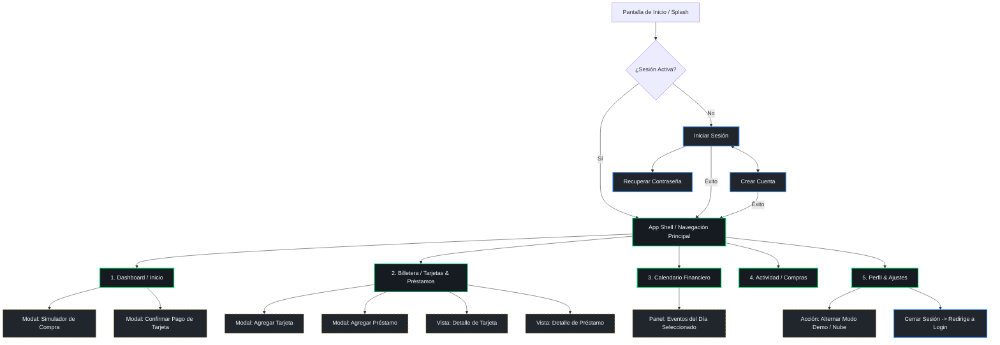
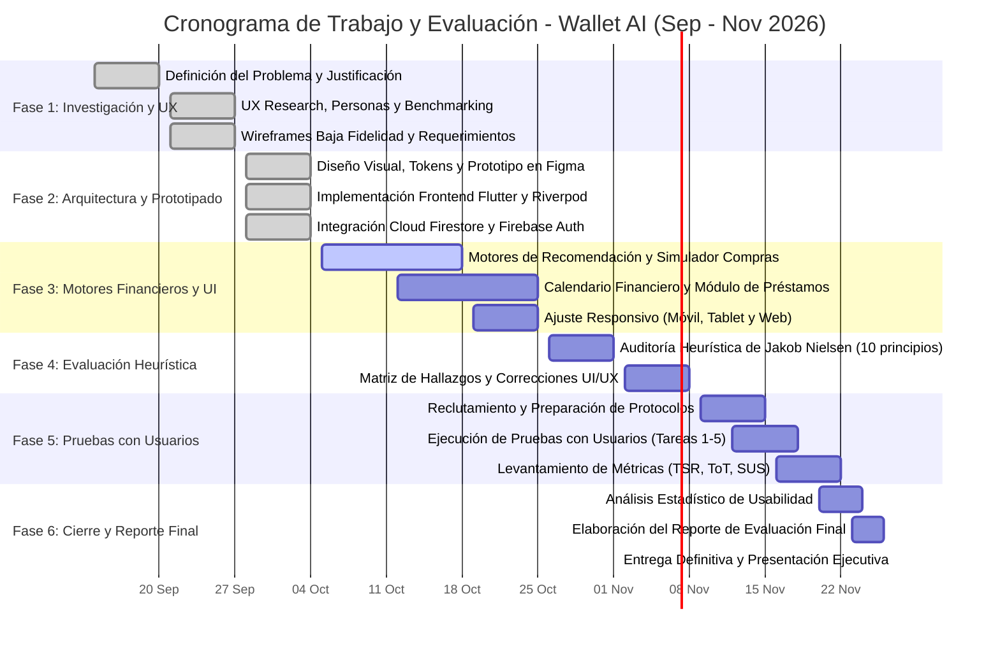

# Wallet AI: Documento de Especificación, Arquitectura de Interfaz y Plan de Evaluación

---

## 1. Información General y Justificación

### 1.1. Título del Proyecto
**Wallet AI: Optimizador Inteligente de Tarjetas de Crédito, Beneficios Financieros y Ciclos de Facturación en la Nube.**

---

### 1.2. Planteamiento del Problema
En el ecosistema financiero contemporáneo, los usuarios bancarizados manejan múltiples tarjetas de crédito, débito y préstamos personales emitidos por diversas instituciones financieras tradicionales y fintechs (BBVA, Nu, Citibanamex, Santander, Banorte, American Express, Hey Banco, entre otros). Esta diversificación genera una problemática cotidiana compleja:

1. **Desconocimiento de Ciclos de Facturación**: La mayoría de los usuarios no tiene presente sus fechas de corte y límites de pago, perdiendo la oportunidad de aprovechar hasta 45 o 50 días de financiamiento libre de intereses que ofrecen los créditos rotativos si se compran en los días inmediatos posteriores al corte.
2. **Pérdida de Beneficios y Recompensas**: Los programas de cashback, puntos por categoría (gasolina, supermercados, viajes, compras en línea) y promociones temporales están fragmentados y con reglas cambiantes. El consumidor promedio termina pagando con cualquier tarjeta a mano, dejando de percibir valor económico directo.
3. **Estrés Financiero y Riesgo de Morosidad**: La falta de una visión consolidada en tiempo real provoca olvidos involuntarios en fechas de pago, incurriendo en comisiones por pago tardío, intereses moratorios y afectaciones negativas al historial crediticio.
4. **Fricción y Desconfianza en Apps Tradicionales**: Las aplicaciones bancarias funcionan en silos cerrados que no se comunican entre sí. Por otro lado, las herramientas agregadoras tradicionales exigen al usuario ingresar credenciales de banca en línea o contraseñas maestras, generando una barrera de seguridad inaceptable y desconfianza fundada en la privacidad de sus datos.

---

### 1.3. Propuesta de Solución
**Wallet AI** es una plataforma basada en la nube (Cloud Platform) y diseñada como un **copiloto financiero proactivo e inteligente**. En lugar de ser un simple visor pasivo de deudas pasadas, Wallet AI procesa en tiempo real las reglas de negocio de los productos bancarios para responder a la pregunta fundamental del usuario en cualquier momento:

> **"¿Qué tarjeta me conviene utilizar hoy y por qué?"**

#### Principios Fundamentales de la Solución:
* **Arquitectura en la Nube Multiplataforma**: Desarrollada sobre Google Cloud Platform y Firebase (Firebase Authentication, Cloud Firestore Serverless), ofreciendo sincronización continua entre dispositivos móviles (iOS, Android) y navegadores web de escritorio.
* **Paradigma Zero-Knowledge de Credenciales**: No solicita ni almacena números completos de tarjeta (PAN), códigos de seguridad (CVV) ni contraseñas bancarias. La plataforma opera exclusivamente con reglas de facturación (día de corte, días para pago, límite de crédito) y alias asignados por el usuario.
* **Motor Determinista de Optimización**: Algoritmos matemáticos desacoplados que calculan los días de financiamiento restantes, proyectan el cashback exacto según la categoría de compra y ordenan las tarjetas del usuario con total transparencia explicativa.
* **Resiliencia Cloud + Offline-First**: La interfaz almacena en caché local toda la información necesaria, permitiendo operar sin conexión en puntos de venta sin cobertura de red y sincronizando automáticamente las transacciones en la nube tan pronto se restablece la conectividad.

---

### 1.4. Objetivos del Proyecto

#### 1.4.1. Objetivo General
Diseñar, implementar y evaluar una plataforma en la nube con una interfaz de usuario reactiva, accesible y de alta fidelidad que permita a los usuarios gestionar y optimizar sus tarjetas de crédito y préstamos, maximizando sus periodos de financiamiento libre de intereses y sus recompensas mediante recomendaciones inteligentes en tiempo real.

#### 1.4.2. Objetivos Específicos (Medibles y Cuantificables)
1. **Eficiencia en Registro y Onboarding**: Reducir el tiempo promedio de registro y alta de la primera tarjeta a **menos de 90 segundos**, simplificando los formularios y ofreciendo catálogos precargados de emisores del mercado mexicano y latinoamericano.
2. **Accesibilidad Visual y Ergonómica**: Cumplir con al menos un **95% de conformidad** con los criterios de las Pautas de Accesibilidad para el Contenido Web (**WCAG 2.1 nivel AA**), garantizando ratios de contraste superiores a 4.5:1 y áreas de interacción táctil mínimas de 48×48 dp.
3. **Disponibilidad y Rendimiento en la Nube**:
   * Mantener un tiempo de despliegue visual inicial (**First Contentful Paint - FCP**) inferior a **1.5 segundos** en web y móvil.
   * Lograr una latencia de sincronización de datos con Firestore inferior a **250 milisegundos** bajo redes 4G estándar.
   * Ofrecer una disponibilidad operativa del servicio en la nube del **99.9%** mediante infraestructura serverless redundante.
4. **Efectividad en la Interfaz (Tasa de Éxito)**: Lograr que al menos el **90% de los usuarios de prueba** completen con éxito y sin asistencia las tareas fundamentales (simulación de compra óptima y consulta de fechas de pago en calendario).
5. **Satisfacción Percibida del Usuario**: Alcanzar una puntuación promedio superior a **80 puntos** en la Escala de Usabilidad del Sistema (**SUS - System Usability Scale**), ubicando la interfaz en el percentil superior (Grado A - "Excelente").

---

## 2. Análisis del Usuario y del Entorno (UX Research)

### 2.1. Perfil de Usuarios (User Personas)

#### Persona 1: Alex "El Maximizador de Recompensas"
* **Demografía**: 27 años, Desarrollador Web / Profesional de Tecnología, Ciudad de México.
* **Nivel Tecnológico**: Avanzado (Power User de apps móviles y servicios en la nube).
* **Instrumentos Financieros**: 4 tarjetas de crédito (Nu Mastercard, Hey Banco, BBVA Oro, Amex Verde).
* **Objetivos y Necesidades**:
  * Desea maximizar cada peso gastado mediante cashback y programas de recompensas por categoría.
  * Requiere saber de un vistazo cuál de sus tarjetas tiene el corte más reciente para aplazar el pago casi dos meses.
  * Valora interfaces minimalistas, en modo oscuro, con tiempos de respuesta instantáneos.
* **Frustraciones**:
  * Olvidar qué tarjeta ofrece el 2% o el 5% en gasolineras vs. compras en línea.
  * Interfaces bancarias lentas, recargadas de publicidad de préstamos no solicitados y que tardan más de 5 segundos en abrir.

#### Persona 2: Mariana "La Emprendedora y Gestora de Flujo de Efectivo"
* **Demografía**: 38 años, Diseñadora de Interiores y Emprendedora, Guadalajara.
* **Nivel Tecnológico**: Medio (utiliza apps de mensajería, banca básica y suites de productividad en la nube).
* **Instrumentos Financieros**: 3 tarjetas de crédito (Santander Fiesta, Banorte Platinum) y 1 préstamo personal de inversión.
* **Objetivos y Necesidades**:
  * Optimizar el flujo de caja de su negocio financiando materiales e insumos hasta 50 días sin pagar un solo peso de intereses.
  * Llevar un calendario transparente donde no se crucen las fechas límite de pago con las fechas de amortización de su préstamo.
* **Frustraciones**:
  * Haber pagado recargos por olvidar una fecha de corte que cayó en fin de semana.
  * Miedo a compartir sus contraseñas bancarias en plataformas que hacen "screen scraping".

#### Persona 3: Carlos "El Consolidador Cuidadoso"
* **Demografía**: 45 años, Contador y Padre de Familia, Monterrey.
* **Nivel Tecnológico**: Medio-Bajo (prudente con la tecnología, enfocado en orden y estabilidad).
* **Instrumentos Financieros**: 2 tarjetas bancarias tradicionales y 1 crédito automotriz.
* **Objetivos y Necesidades**:
  * Visualizar claramente su nivel de endeudamiento global y crédito disponible total.
  * Recibir alertas preventivas antes del vencimiento sin saturación de notificaciones invasivas.
* **Frustraciones**:
  * Términos bancarios oscuros (pago para no generar intereses vs. saldo al corte vs. saldo actual).
  * Tablas de Excel manuales que quedan desactualizadas y consumen horas a la semana.

---

### 2.2. Casos de Uso y Escenarios de Interacción

```mermaid
journey
    title Escenarios Típicos de Interacción con Wallet AI
    section Escenario 1: Decisión en Punto de Venta
      Llega a caja en el supermercado: 3: Alex
      Abre Wallet AI (carga <1.5s): 5: Alex
      Ingresa $1,800 y selecciona "Supermercado": 5: Alex
      Recomendador indica: "Usa Hey Banco (2% cashback, +42 días)": 5: Alex
      Paga seguro sabiendo el beneficio: 5: Alex
    section Escenario 2: Planificación de Compra Mayor
      Mariana cotiza equipo por $25,000 MXN: 3: Mariana
      Consulta el Dashboard de Wallet AI: 4: Mariana
      Observa que Tarjeta BBVA corta en 24 horas: 5: Mariana
      Decide esperar al día siguiente para obtener 50 días de crédito: 5: Mariana
    section Escenario 3: Control Mensual y Prevención de Mora
      Carlos revisa su Calendario Financiero: 4: Carlos
      Alerta ámbar: Pago de $4,500 en 3 días: 4: Carlos
      Efectúa el pago en su app bancaria y marca "Pagado" en Wallet AI: 5: Carlos
      El indicador de crédito total se recalcula al instante: 5: Carlos
```

* **Escenario 1 (Decisión en Punto de Venta)**: El usuario está formado en la caja registradora de una tienda de autoservicio. Abre la aplicación, utiliza el "Simulador de Compra", ingresa la cantidad estimada y la categoría; en dos toques de pantalla obtiene la recomendación de la tarjeta con mayor retorno y días de financiamiento, evitando la indecisión.
* **Escenario 2 (Diferimiento Estratégico)**: Un usuario planea adquirir boletos de avión o equipo electrónico costoso. Al abrir Wallet AI, el Hero Card le advierte que su tarjeta principal corta en 36 horas; el usuario posterga la transacción un día y medio, logrando 50 días de financiamiento gratis en lugar de tener que liquidar la compra en solo 10 días.
* **Escenario 3 (Prevención de Pago Tardío)**: En la pestaña de Calendario, las fechas límite de pago se destacan en color ámbar y rojo según su proximidad. El usuario revisa sus compromisos semanales, efectúa los pagos correspondientes y los marca en la app, manteniendo su índice de utilización crediticia en verde.

---

### 2.3. Análisis de la Competencia (Benchmarking)

| Parámetro de Comparación | Apps Bancarias Propias (BBVA, Nu, Citibanamex) | Agregadores de Finanzas (Fintonic, Zenfi) | Hojas de Cálculo (Excel, Notion) | **Wallet AI (Nuestra Propuesta)** |
| :--- | :--- | :--- | :--- | :--- |
| **Visión Multibanco** | ❌ No (Solo datos de su propio banco) | ✅ Sí | ✅ Sí (Manual) | **✅ Sí (Universal y Unificada)** |
| **Recomendador de Tarjeta Óptima** | ❌ No | ❌ No | ❌ No | **✅ Sí (En tiempo real por días y cashback)** |
| **Privacidad / Requerimiento de Credenciales** | Alta (Requiere cuenta nativa) | ⚠️ Pobre (Exige contraseñas y banca en línea) | Alta (Local) | **🔒 Máxima (Zero-Knowledge, sin contraseñas ni PAN)** |
| **Modo Fuera de Línea (Offline-First)** | ❌ Requiere internet obligatorio | ❌ Requiere internet | ✅ Sí | **✅ Sí (Caché local con sincronización cloud)** |
| **Simulador de Compra en Caja** | ❌ Inexistente | ❌ Inexistente | ❌ Inexistente | **✅ Sí (Cálculo instantáneo por categoría)** |
| **Control de Préstamos Integrado** | ❌ Aislado por institución | ⚠️ Parcial | ✅ Manual | **✅ Sí (Unificado con tarjetas en Billetera)** |
| **Curva de Aprendizaje** | Media | Media | Muy Alta | **Baja (< 2 minutos para dominar)** |

---

## 3. Requerimientos de la Interfaz en la Nube

### 3.1. Requerimientos Funcionales (RF)

* **RF-01: Autenticación Segura en la Nube**:
  * Registro e inicio de sesión con correo electrónico y contraseña gestionados por Firebase Auth.
  * Cierre de sesión seguro y persistencia del token de sesión en almacenamiento encriptado del dispositivo.
  * Manejo visual de errores de credenciales (correo duplicado, contraseña débil, cuenta no existente) mediante banners descriptivos.
* **RF-02: Gestión de Billetera (Tarjetas y Préstamos)**:
  * Alta, consulta, edición y eliminación (CRUD) de tarjetas de crédito y préstamos personales.
  * Selección asistida de emisor bancario y red de procesamiento (Visa, Mastercard, American Express).
  * Captura de parámetros clave: día de corte mensual, días naturales para pago, límite de crédito y saldo aproximado.
* **RF-03: Motor de Recomendación Diaria**:
  * Presentación visual en el Dashboard de la tarjeta recomendada del día en un componente destacado (Hero Card).
  * Justificación textual y gráfica del motivo: días restantes de financiamiento sin intereses, porcentaje de recompensa y proximidad de corte.
* **RF-04: Simulador Interactivo de Compras ("Smart Purchase")**:
  * Entrada numérica de importe monetario con formato monetario automático ($ MXN).
  * Selector visual de categorías (Supermercado, Gasolina, Restaurantes, Viajes, En línea, Servicios, General).
  * Matriz comparativa en tiempo real de todas las tarjetas activas ordenadas de mayor a menor conveniencia.
* **RF-05: Calendario Financiero Unificado**:
  * Visualización mensual interactiva con indicadores cromáticos diferenciados para Fechas de Corte (azul), Fechas Límite de Pago (naranja/ámbar) y Vencimiento de Préstamos (morado).
  * Desglose inferior en lista cronológica de eventos al seleccionar un día específico.
* **RF-06: Control de Préstamos y Amortizaciones**:
  * Monitoreo de saldo original, saldo insoluto actual y porcentaje de avance de pago.
  * Registro visual de abonos a capital y pagos ordinarios con actualización del estado en la nube.
* **RF-07: Sincronización en Tiempo Real y Modo Demo**:
  * Sincronización reactiva con Cloud Firestore mediante flujos de datos (`StreamProvider`).
  * Switch de entorno que permite alternar entre el backend real en la nube y un juego de datos demostrativos locales (Aurora, Horizonte, Prisma) para pruebas inmediatas sin conexión.
* **RF-08: Gestión de Perfil y Preferencias**:
  * Visualización de información de usuario, configuración de moneda, alternancia de tema visual (Claro/Oscuro) y exportación o purga de datos.

---

### 3.2. Requerimientos No Funcionales (RNF) con Enfoque en la Nube

* **RNF-01: Responsividad Multi-Entorno**:
  * La interfaz debe renderizarse de manera fluida y proporcional en dispositivos móviles (360px a 430px de ancho), tabletas (768px a 1024px) y ventanas de navegador de escritorio (> 1200px).
  * En resoluciones amplias de escritorio, la navegación inferior (BottomNavigationBar) se transforma automáticamente en un riel lateral (Navigation Rail), optimizando el aprovechamiento del lienzo.
* **RNF-02: Disponibilidad y Resiliencia (Cloud + Offline-First)**:
  * Disponibilidad del backend en la nube del **99.9%**, respaldada por los Acuerdos de Nivel de Servicio (SLA) de Google Cloud.
  * Resiliencia total ante intermitencias de red: la aplicación opera con normalidad utilizando persistencia local en disco de Firestore y la capa de almacenamiento offline, sincronizando los cambios pendientes al recuperar conectividad.
* **RNF-03: Rendimiento y Tiempos de Carga**:
  * Despliegue de la pantalla principal en menos de **1.5 segundos** en frío.
  * Tasa de refresco constante de **60 cuadros por segundo (FPS)** en todas las animaciones y transiciones de pantalla.
  * Operaciones de lectura y escritura en la nube completadas en menos de **250 ms**.
* **RNF-04: Seguridad, Privacidad y Confianza Visual**:
  * Reglas de seguridad estrictas en Cloud Firestore (`firestore.rules`): denegación por defecto y acceso restringido exclusivamente al propietario autenticado (`request.auth.uid == userId`).
  * Toda la comunicación de red debe cifrarse bajo protocolo **TLS 1.3 / HTTPS**.
  * Enmascaramiento visual de números de plástico: nunca mostrar más de los últimos 4 dígitos (`•••• 4242`), reforzando visualmente la tranquilidad del usuario.
* **RNF-05: Retroalimentación y Estado del Sistema (Feedback UX)**:
  * Cada acción asíncrona de red debe contar con indicadores visuales de progreso no intrusivos (efectos shimmer tipo esqueleto) en lugar de pantallas congeladas o bloqueantes.
  * Banner visual informativo discreto cuando la app detecta que se encuentra operando en modo sin conexión.
* **RNF-06: Consistencia y Accesibilidad**:
  * Aplicación estricta de las directrices de Material Design 3.
  * Relación de contraste de texto normal sobre fondo de al menos **4.5:1** y de texto grande/iconos de al menos **3.0:1**, compatible con validadores automáticos y lectores de pantalla.

---

## 4. Arquitectura de Información y Diseño Visual

### 4.1. Flujo de Navegación y Mapa del Sitio



---

### 4.2. Sistema de Tokens de Diseño y Guía Visual

#### 4.2.1. Filosofía de Estilo: "Modern Minimalist Fintech"
El lenguaje visual de Wallet AI se aleja de la agresividad cromática tradicional bancaria (rojos punitivos de cobro). Utiliza una paleta moderna, profesional y orientada al bienestar financiero:

* **Fondo Oscuro Profundo (Obsidian `#0D1117`)**: Reduce la fatiga visual y resalta los elementos de información clave con alto contraste.
* **Superficies Elevadas (`#161B22` y `#21262D`)**: Tarjetas virtuales con bordes sutiles y sombras de difusión suave que generan sensación de profundidad física.
* **Verde Menta Esmeralda (`#00D26A`)**: Color de marca primario que transmite crecimiento patrimonial, liquidez positiva y seguridad.
* **Azul Eléctrico Fintech (`#388BFD`)**: Acentos secundarios para conectividad en la nube, botones interactivos y fechas de corte.
* **Ámbar Cálido (`#D29922`)**: Advertencias preventivas de cortes y pagos cercanos (3 días o menos), guiando la atención del usuario sin generar pánico.
* **Tipografía**: Jerarquía clara basada en Inter / Roboto, con tamaños de escala tipográfica desde 12sp (etiquetas y chips) hasta 32sp (métricas de saldo y saldo disponible).

---

### 4.3. Herramientas de Diseño a Utilizar
1. **Figma**: Software principal de diseño UI/UX en la nube para la elaboración de la biblioteca de componentes atómicos, auto-layouts responsivos, variantes interactivas de tarjetas y microinteracciones de navegación.
2. **Penpot**: Herramienta de diseño open-source basada en estándares web utilizada para pruebas de prototipado colaborativo y verificación de estilos CSS/SVG multiplataforma.
3. **Flutter Canvas & Widgets**: Entorno de prototipado dinámico de alta fidelidad, permitiendo traducir los tokens visuales directamente a código ejecutable en Android, iOS, Web y macOS.

---

### 4.4. Entregables de Diseño Previstos
* **Bocetos Iniciales (Wireframes de Baja Fidelidad)**: Esquemas estructurales en escala de grises centrados en la jerarquía de contenidos, disposición de menús y flujos de pantallas sin distracción de color.
* **Wireframes de Media Fidelidad**: Diagramas interactivos con definición de componentes, relaciones espaciales y validación de adaptabilidad entre dispositivos móviles y pantallas de escritorio.
* **Prototipo Interactivo de Alta Fidelidad**: Prototipo final navegable desarrollado con soporte de Dark Mode y Light Mode, transiciones animadas de 300 ms, persistencia de datos en Firestore y microinteracciones de estado.

---

## 5. Plan de Evaluación de la Interfaz

Para garantizar una experiencia de usuario sólida y profesional, se define un plan de evaluación integral fundamentado en dos enfoques complementarios: inspección por expertos y pruebas empíricas con usuarios finales.

---

### 5.1. Métodos de Evaluación

#### Enfoque A: Evaluación Heurística (Principios de Jakob Nielsen)
Auditoría técnica efectuada por el equipo de desarrollo e inspectores pares, evaluando la interfaz bajo los 10 principios heurísticos clásicos de usabilidad:

1. **Visibilidad del Estado del Sistema**: Indicadores visuales en tiempo real del estado de conexión (Nube vs. Local), animaciones shimmer durante la carga de saldos y alertas visuales cuando un pago está próximo a vencer.
2. **Coincidencia entre el Sistema y el Mundo Real**: Uso de conceptos y convenciones financieras claras (Fecha de Corte, Fecha Límite de Pago, Cashback, Saldo Disponible) representadas con tarjetas visuales que imitan la estética de los plásticos bancarios reales.
3. **Control y Libertad del Usuario**: Capacidad de cancelar la adición o edición de una tarjeta en cualquier momento, diálogos de confirmación para acciones irreversibles (eliminar tarjeta o préstamo) y navegación reversible con botón atrás persistente.
4. **Consistencia y Estándares**: Mantenimiento de la misma disposición de controles en todas las pestañas, uso estandarizado de colores (verde para saldo a favor, ámbar para pagos cercanos, azul para cortes) y alineación con Material Design 3.
5. **Prevención de Errores**: Formateo automático de importes en pesos mexicanos ($ MXN), validación en tiempo real de días del mes (1 a 31), deshabilitación de botones de acción cuando los campos obligatorios están incompletos.
6. **Reconocimiento antes que Recuerdo**: El simulador de compra ofrece categorías visuales con iconos reconocibles en lugar de obligar al usuario a escribir texto libre; el Dashboard muestra de inmediato la tarjeta recomendada sin exigir cálculos manuales.
7. **Flexibilidad y Eficiencia de Uso**: Atajos rápidos en el Dashboard para simular compra y marcar pagos con un solo toque; opción de navegación por teclado y riel lateral responsivo en versiones web/escritorio.
8. **Diseño Estético y Minimalista**: Eliminación de banners publicitarios y datos redundantes. Cada pantalla muestra únicamente la información necesaria para la toma de decisión del usuario.
9. **Ayuda a los Usuarios a Reconocer, Diagnosticar y Recuperar Errores**: Mensajes de error claros en español, evitando códigos de error crudos de base de datos; sugerencias directas de solución (ej. "Ingresa un correo con formato válido", "La contraseña debe tener al menos 6 caracteres").
10. **Ayuda y Documentación**: Información explicativa integrada mediante tooltips y textos secundarios en las pantallas de configuración y detalles de beneficios.

##### Escala de Severidad de Problemas Heurísticos:
* **0**: No representa un problema de usabilidad.
* **1 (Cosmético)**: Detalle estético menor que no afecta la operación; reparación de baja prioridad.
* **2 (Menor)**: Incomodidad leve que ralentiza al usuario pero no bloquea la tarea.
* **3 (Mayor)**: Problema severo que confunde al usuario o genera errores recurrentes; debe corregirse con alta prioridad.
* **4 (Catastrófico)**: Error crítico que impide por completo completar la tarea o corrompe datos; debe resolverse de inmediato.

---

#### Enfoque B: Pruebas de Usabilidad con Usuarios Reales (Task-Based Testing)
Se llevarán a cabo sesiones de evaluación moderada con una muestra de **6 a 8 participantes** representativos de los perfiles de usuario identificados (Alex, Mariana y Carlos).

##### Protocolo de Tareas Específicas a Evaluar:
* **Tarea 1 (Registro y Acceso)**: "Crea una nueva cuenta de usuario con tu correo electrónico e inicia sesión en la plataforma".
* **Tarea 2 (Alta de Tarjeta)**: "Registra una tarjeta de crédito Nu con límite de $15,000 MXN, día de corte el 12 de cada mes y 20 días para pagar".
* **Tarea 3 (Consulta de Recomendación Diaria)**: "Identifica en la pantalla principal cuál es la tarjeta recomendada para usar el día de hoy y explica por qué la seleccionó el sistema".
* **Tarea 4 (Simulación de Compra)**: "Utiliza el simulador de compras para evaluar una compra de $1,500 MXN en la categoría 'Supermercado' e indica cuál tarjeta resultó en primer lugar".
* **Tarea 5 (Consulta de Calendario y Fechas Clave)**: "Localiza en el calendario financiero cuál es la fecha límite de pago más próxima que tienes pendiente este mes".

---

### 5.2. Métricas de Usabilidad Cuantitativas y Cualitativas

1. **Tasa de Éxito de Tareas (Task Success Rate - TSR)**:
   $$\text{TSR} = \left( \frac{\text{Tareas completadas con éxito}}{\text{Total de tareas asignadas}} \right) \times 100$$
   * **Meta de Calidad**: Superior o igual al **90%** en todas las tareas evaluadas.
2. **Tiempo Promedio de Finalización de Tarea (Time on Task - ToT)**:
   * **Metas**:
     * Tarea 1 (Registro): $< 90$ segundos.
     * Tarea 2 (Alta de tarjeta): $< 60$ segundos.
     * Tarea 3 (Consulta de recomendación): $< 15$ segundos.
     * Tarea 4 (Simulación de compra): $< 30$ segundos.
     * Tarea 5 (Consulta de calendario): $< 20$ segundos.
3. **Tasa de Errores por Tarea (Error Rate)**: Número de clics o pasos incorrectos antes de alcanzar el objetivo. Meta: Menos de **0.5 errores promedio** por tarea.
4. **Escala de Usabilidad del Sistema (System Usability Scale - SUS)**:
   * Cuestionario estandarizado de 10 reactivos al finalizar la sesión con escala Likert de 1 a 5.
   * **Meta del Proyecto**: Obtener un puntaje global superior a **80 puntos**, posicionando a Wallet AI en el rango de usabilidad **Grado A (Excelente)**.
5. **Índice de Esfuerzo Percibido (Single Ease Question - SEQ)**: Pregunta directa de 1 a 7 tras completar cada tarea ("¿Qué tan fácil o difícil fue realizar esta acción?"). Meta: Promedio $\ge 6.0 / 7.0$.

---

## 6. Cronograma y Viabilidad

### 6.1. Marco Temporal y Contexto de Ejecución
El proyecto comprende un ciclo integral de desarrollo y evaluación de **11 semanas**, habiendo dado inicio hace **3 semanas** (a mediados de septiembre de 2026) y programando su entrega final y presentación de resultados a **finales de noviembre de 2026** (semana del 23 al 27 de noviembre de 2026).

* **Fecha de Inicio del Proyecto**: 14 de Septiembre de 2026.
* **Fecha Actual de Estado**: Principios de Octubre de 2026 (Semana 3-4: plataforma base construida, arquitectura en la nube con Firebase Auth y Firestore operativa, suite de 33 pruebas unitarias aprobadas y prototipo interactivo funcional).
* **Fecha Límite de Entrega Final**: 27 de Noviembre de 2026 (Semana 11).

---

### 6.2. Plan de Trabajo e Hitos Semanales (Cronograma de Gantt)



#### Desglose de Hitos por Semanas:

| Semana | Fechas (2026) | Fase | Actividades y Entregables | Estado |
| :---: | :---: | :--- | :--- | :---: |
| **Semana 1** | 14 Sep - 20 Sep | Investigación Inicial | • Planteamiento del problema y objetivos del proyecto.<br>• Justificación de la solución en la nube y modelo Zero-Knowledge. | **Completado** |
| **Semana 2** | 21 Sep - 27 Sep | UX Research & Concepto | • Definición de User Personas y escenarios de interacción.<br>• Análisis de la competencia (Benchmarking).<br>• Especificación de requerimientos funcionales y no funcionales.<br>• Primeros wireframes de baja fidelidad. | **Completado** |
| **Semana 3** | 28 Sep - 04 Oct | Arquitectura y Prototipado Base | • Configuración de entorno en Google Cloud y Firebase.<br>• Despliegue de reglas de seguridad en Cloud Firestore.<br>• Integración de autenticación de usuarios (Firebase Auth).<br>• Construcción de la interfaz base en Flutter (Shell y pestañas).<br>• Creación de suite de pruebas unitarias (33 tests exitosos). | **Completado** |
| **Semana 4** | 05 Oct - 11 Oct | Motores y Lógica de Negocio | • Perfeccionamiento del motor de recomendación diaria.<br>• Desarrollo visual del Hero Card en Dashboard.<br>• Implementación del Simulador de Compras por categoría. | *En Curso* |
| **Semana 5** | 12 Oct - 18 Oct | Calendario y Préstamos | • Implementación de la vista interactiva de Calendario Financiero.<br>• Integración del módulo de préstamos y amortizaciones.<br>• Conexión de flujos reactivos de datos en la nube. | *Planificado* |
| **Semana 6** | 19 Oct - 25 Oct | Responsividad y Polish | • Adaptación de diseño responsivo (móvil, tablet, escritorio).<br>• Ajuste de tokens de accesibilidad (contraste WCAG 2.1 AA).<br>• Manejo de estados de carga (shimmers) y banners offline. | *Planificado* |
| **Semana 7** | 26 Oct - 01 Nov | Evaluación Heurística | • Ejecución de auditoría experta bajo los 10 principios de Nielsen.<br>• Clasificación de severidad de hallazgos (0 a 4). | *Planificado* |
| **Semana 8** | 02 Nov - 08 Nov | Refactorización UI/UX | • Corrección prioritaria de problemas heurísticos identificados.<br>• Optimización de microinteracciones y textos de retroalimentación. | *Planificado* |
| **Semana 9** | 09 Nov - 15 Nov | Pruebas de Usabilidad (Prep) | • Reclutamiento de 6-8 usuarios representativos.<br>• Preparación del laboratorio de pruebas y guion de tareas (1 a 5). | *Planificado* |
| **Semana 10** | 16 Nov - 22 Nov | Ejecución con Usuarios | • Aplicación de pruebas moderadas con usuarios.<br>• Medición de tiempos por tarea (ToT), tasas de éxito (TSR) y errores.<br>• Aplicación del cuestionario estandarizado SUS. | *Planificado* |
| **Semana 11** | 23 Nov - 27 Nov | Consolidación y Cierre | • Tabulación y análisis de datos de usabilidad.<br>• Elaboración del Reporte Final de Evaluación de Interfaz.<br>• **Entrega formal del proyecto y presentación ejecutiva (27 de Noviembre)**. | *Hito Crítico* |

---

### 6.3. Análisis de Viabilidad

1. **Viabilidad Técnica**:
   * La combinación de **Flutter** (framework multiplataforma nativo compilado con gráficos skia/impeller) y **Firebase** (Google Cloud Serverless) garantiza un desarrollo unificado sin disparidad de código entre plataformas web y móviles.
   * La lógica de recomendación es determinista y no depende de llamadas lentas o costosas a modelos externos, asegurando tiempos de ejecución en el orden de microsegundos directamente en el dispositivo cliente.
2. **Viabilidad Operativa y de Seguridad**:
   * Al adoptar una filosofía **Zero-Knowledge**, se eliminan los riesgos legales y regulatorios asociados al manejo de números de tarjeta (PCI-DSS nivel 1) o contraseñas bancarias (Open Banking complejo).
   * La curva de aprendizaje para el usuario es mínima, ya que utiliza conceptos que ya conoce de su vida financiera diaria.
3. **Viabilidad Económica**:
   * El proyecto opera dentro del nivel gratuito de Google Cloud Platform y Firebase (Spark Plan), lo que permite soportar miles de lecturas y escrituras mensuales sin costo de infraestructura para el prototipo y las pruebas de usabilidad.
4. **Viabilidad Temporal**:
   * Las fechas están calculadas de manera realista: con la base técnica, la autenticación y el almacenamiento en la nube ya construidos en las primeras 3 semanas, el tiempo restante (8 semanas) es perfectamente holgado para refinar la interacción, ejecutar la evaluación heurística con rigor y realizar las pruebas empíricas con usuarios antes del 27 de noviembre de 2026.
