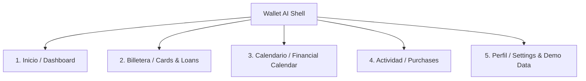

# Wallet AI - UI/UX Design Specification

## 1. Filosofía de Diseño Fintech

Wallet AI está diseñada bajo los principios de la **Experiencia Fintech Contemporánea**:
* **Sofisticación Minimalista**: Fondos limpios, jerarquía tipográfica precisa, tarjetas flotantes con elevación sutil y sombras de difusión suave.
* **Empatía y Calma Financiera**: Se eliminan colores rojos agresivos de cobranza tradicional; las alertas de proximidad de pago usan tonos ámbar cálidos y los cortes recién iniciados usan verdes esmeralda y azules cerúleos.
* **Interactividad Táctil**: Indicadores visuales de ciclo de facturación circulares y lineales con animaciones fluidas de 300ms a 60fps.

---

## 2. Sistema de Tokens de Diseño

### 2.1. Paleta de Colores

#### Dark Mode (Por defecto en Fintech)
* **Background Principal**: `#0D1117` (Obsidian Deep)
* **Surface / Tarjeta**: `#161B22` (Graphite Layer)
* **Surface Highlight**: `#21262D` (Card Border & Elevation)
* **Brand Primary**: `#00D26A` (Emerald Mint - Crecimiento & Dinero)
* **Brand Secondary**: `#388BFD` (Fintech Electric Blue)
* **Brand Accent**: `#8A05BE` (Purple Nu / Premium Accent)
* **Warning / Proximidad**: `#D29922` (Warm Amber - Vence en <3 días)
* **Critical / Vencido**: `#F85149` (Coral Alert)
* **Text High Contrast**: `#F0F6FC`
* **Text Medium Contrast**: `#8B949E`
* **Text Subtle / Muted**: `#484F58`

#### Light Mode
* **Background Principal**: `#F6F8FA`
* **Surface / Tarjeta**: `#FFFFFF`
* **Brand Primary**: `#008744`
* **Brand Secondary**: `#0969DA`
* **Text High Contrast**: `#1F2328`
* **Text Medium Contrast**: `#57609A`

---

## 3. Arquitectura de Navegación

Bottom Navigation Bar persistente con 5 destinos clave:

---

## 4. Especificación de Pantallas Principales

### 4.1. Dashboard (Inicio)
1. **Header**: Saludo personalizado ("Hola, Alex 👋"), fecha actual destacada, chip de entorno (`Modo Demo Local` o `En línea`).
2. **Hero Card: "Tarjeta Recomendada de Hoy"**:
   - Tarjeta virtual interactiva con gradiente del emisor.
   - Badge "🌟 Mejor opción hoy".
   - Motivo clave destacado: "Ciclo nuevo (+42 días de financiamiento libre)".
   - Métricas clave: Días disponibles, cashback estimado, fecha de pago.
   - Acciones: `Simular Compra` y `Ver Detalles`.
3. **Métricas Rápidas de Liquidez**:
   - Crédito total disponible ($94,500.00 MXN).
   - Saldo utilizado consolidado ($18,200.00 MXN).
   - Porcentaje de uso global (16% - Nivel Óptimo en barra segmentada).
4. **Próximos Pagos Urgentes**:
   - Tarjetas que vencen en los próximos 7 días con botón de acción rápida "Marcar Pagado".
5. **Acceso al Asistente de Compras**: Barra rápida de búsqueda / simulación.

### 4.2. Billetera Virtual (Cards & Loans)
* **Selector Segmentado**: `Mis Tarjetas (4)` / `Mis Préstamos (1)`.
* **Carrusel o Lista de Tarjetas Digitales**:
  - Emisor (Nu, BBVA, Santander, Aurora).
  - Chip de red (Visa, Mastercard, Amex).
  - Alias y últimos 4 dígitos.
  - Barra de progreso del ciclo: días transcurridos desde el corte vs días restantes.
  - Barra de utilización de crédito con color semafórico.
  - Chips de beneficios activos: "3% Supermercado", "2% Gasolina".
* **Floating Action Button**: `+ Nueva Tarjeta` o `+ Nuevo Préstamo`.

### 4.3. Detalle de Tarjeta
* Visualización grande de la tarjeta con flip de animación para consultar notas.
* Información detallada de corte:
  - Fecha de corte anterior y fecha de próximo corte.
  - Fecha límite de pago con contador regresivo ("Faltan 14 días").
  - Regla aplicada ("Corte día 14, pago 20 días después").
* Desglose de beneficios activos y promociones temporales.
* Historial de compras asignadas a este ciclo.
* Botón de edición y opción de archivar/eliminar con diálogo de confirmación.

### 4.4. Asistente / Simulador de Compras ("Smart Purchase")
* Input de importe monetario con formato en tiempo real ($ MXN).
* Carrusel selector de categoría con iconos (🛒 Supermercado, ⛽ Gasolina, 🍽️ Restaurantes, ✈️ Viajes, 🛍️ En línea, etc.).
* **Matriz Comparativa en Vivo**:
  - Lista clasificada de todas las tarjetas del usuario.
  - #1 Recomendada con badge destacado y ahorro calculado.
  - Comparativa transparente: Cashback en pesos, Días de crédito disponibles, Saldo restante posterior a la compra.

### 4.5. Calendario Financiero
* Selector mensual y semanal con navegación interactiva.
* Días con badges circulares codificados por color:
  - 🔵 Azul: Fecha de Corte.
  - 🟠 Naranja / Ámbar: Fecha Límite de Pago.
  - 🟣 Morado: Vencimiento de Préstamo.
* Vista inferior con la lista cronológica de eventos del día seleccionado.

### 4.6. Gestión de Préstamos
* Tarjeta de préstamo con monto original, saldo insoluto actual y porcentaje de amortización completado.
* Cuota programada y fecha de próximo cobro.
* Botón para registrar abono a capital o pago ordinario.

---

## 5. Estados del Sistema

* **Estado de Carga (Loading / Skeleton Shimmer)**: Placeholders con gradiente animado en lugar de spinners genéricos para una percepción de fluidez instantánea.
* **Estado Vacío (Empty State)**: Ilustración limpia, texto empático y botón de llamada a la acción ("Agrega tu primera tarjeta o activa el set de datos de demostración").
* **Estado de Error**: Mensaje explicativo en español claro, sin tecnicismos crudos de backend, con botón de "Reintentar".
* **Modo Offline**: Banner sutil no intrusivo indicando "Operando en modo sin conexión con datos locales".
